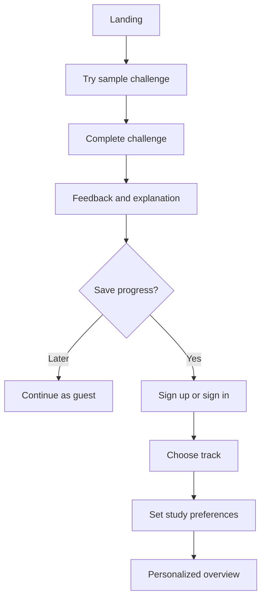
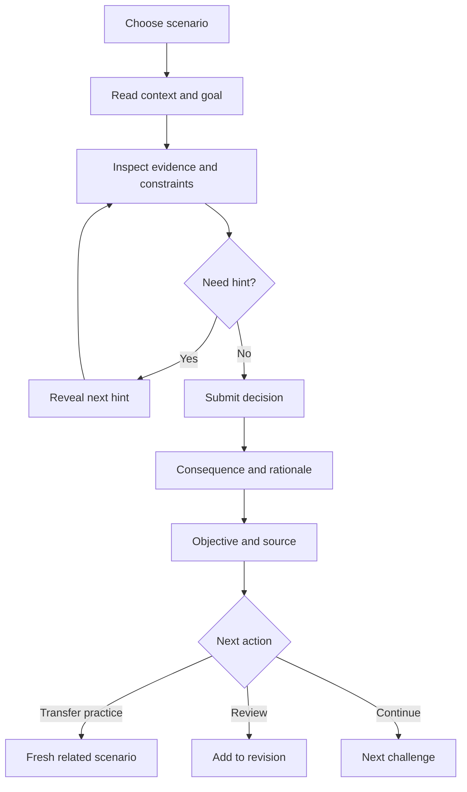

# User Flows and Navigation

## Main navigation
- Overview: active track, continue action, due reviews, next recommendation.
- Scenario Lab: browse/resume challenges.
- Architecture Canvas: guided design challenges and saved diagrams.
- Revision Studio: due concepts and recall review.
- Progress: objective evidence and activity.
- Learning Tracks: select provider/goal and inspect availability.
- Profile/Settings: account, preferences, privacy/data controls.

Keep navigation labels simple. Use responsive navigation on mobile and a clear active state.

## Guest-to-account journey

Guest progress migration is optional; if implemented, explain what transfers and request consent.

## Scenario journey

## Canvas journey
1. Explain task and constraints.
2. Introduce palette.
3. Add components and connections.
4. Validate structural issues helpfully.
5. Select a simulation event.
6. Run deterministic rules.
7. Display findings, assumptions, and explanation.
8. Offer reflection, retry, or related scenario.
9. Save locally or to account depending on persistence.

## Revision journey
Due list → recall prompt → reveal explanation/source → Again/Hard/Recalled → update schedule and evidence.

## UX edge cases
- New learner: offer a diagnostic, not an empty dashboard.
- No reviews due: recommend a new challenge without guilt messaging.
- Track has no reviewed content: say so plainly.
- AI unavailable: curated lessons remain usable.
- Auth failure: provide recovery guidance without exposing account details.
- Unsupported simulation: explain scope; do not imply complete validation.
- Mobile canvas: zoom/select/list controls; never require precise dragging.
